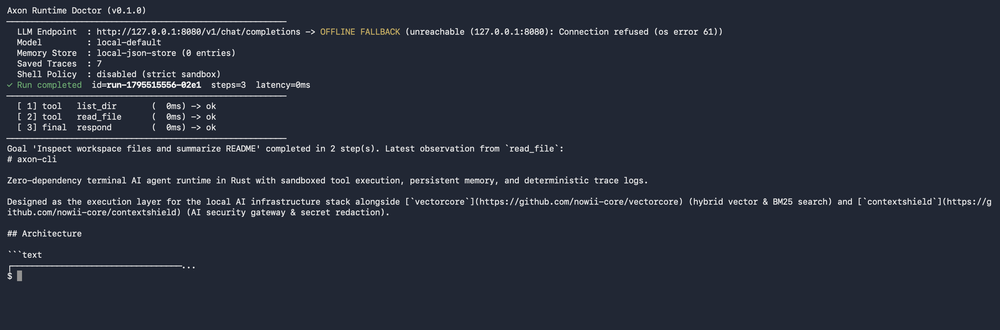

<div align="center">
  <h1>axon-cli</h1>
  <p><strong>A zero-dependency terminal AI agent runtime in pure Rust.</strong></p>
  <p>Version 0.1.0 · nowii-core · Bounded Agent Loop · Sandboxed Tools · Deterministic Traces</p>
</div>

<p align="center">
  <a href="./LICENSE"></a>
  
  
  
  
  
</p>

<p align="center">
  <a href="#overview">Overview</a> |
  <a href="#preview">Preview</a> |
  <a href="#runtime-snapshot">Runtime Snapshot</a> |
  <a href="#key-features">Features</a> |
  <a href="#quick-start">Quick Start</a> |
  <a href="#cli-commands">CLI Commands</a> |
  <a href="#storage--safety">Storage & Safety</a> |
  <a href="#development">Development</a> |
  <a href="#contact--support">Contact</a>
</p>

---

## Overview

Most terminal agent runners bring in heavy external crates, complex runtimes, or opaque execution loops before you can inspect what the agent actually did. **axon-cli takes a zero-dependency, systems-first approach:** it implements a bounded agent execution loop, sandboxed tool calls, local persistent memory, and deterministic trace logging from scratch in pure Rust.

Designed as the execution layer for a local-first AI stack alongside [`vectorcore`](https://github.com/nowii-core/vectorcore) (hybrid vector & BM25 search) and [`contextshield`](https://github.com/nowii-core/contextshield) (AI security gateway & secret redaction), `axon-cli` keeps execution inspectable, predictable, and self-contained.

```text
axon-cli
  ├── CLI Commands (doctor, run)
  ├── Bounded Agent Execution Loop (list_dir -> read_file -> final respond)
  ├── Strict Sandbox & Shell Policy (disabled by default)
  ├── Local JSON Memory Store (.axon/)
  └── Deterministic Execution Trace Logs (.axon/)
```

`axon-cli` is written in pure Rust with zero external runtime dependencies.

---

## Preview



> **Deterministic Local Execution:** Runs bounded goal loops (`list_dir`, `read_file`, `respond`) with sub-millisecond local step timing and automatic offline fallback when no local LLM endpoint is active.

---

## Runtime Snapshot

Measured on local release build (`v0.1.0`, goal: `"Inspect workspace files and summarize README"`, strict sandbox):

| Metric / Component | Status / Result | Notes |
| :--- | :--- | :--- |
| **Runtime Version** | `v0.1.0` | Zero-dependency Rust release binary |
| **Execution Loop** | `3 steps` (`2` tool steps + `respond`) | Bounded `list_dir` -> `read_file` -> `final` flow |
| **Step Latency** | `0ms` per step | Local deterministic execution |
| **LLM Endpoint Fallback** | `OFFLINE FALLBACK` (`127.0.0.1:8080`) | Cleanly continues when local model endpoint is offline |
| **Shell Policy** | `disabled (strict sandbox)` | Shell execution blocked by default |

> **Run it yourself:** `./target/release/axon-cli doctor` and `./target/release/axon-cli run "Inspect workspace files and summarize README"`

---

## Key Features

- **Zero External Dependencies:** Built in pure Rust with no external runtime dependencies for fast builds, small footprint, and predictable behavior.
- **Sandboxed Tool Execution:** Executes bounded step loops (`list_dir`, `read_file`, final `respond`) under a strict sandbox with shell execution disabled by default.
- **Persistent Local Memory:** Stores local JSON memory state under `.axon/` across runs without requiring external databases.
- **Deterministic Trace Logs:** Persists step-by-step execution records and timing details under `.axon/` for inspection and debugging.
- **Runtime Diagnostics (`axon-cli doctor`):** Audits workspace and state directories, LLM endpoint status (with offline fallback), memory store state, saved trace count, and shell policy.
- **Goal Runner (`axon-cli run`):** Runs goal-oriented tasks and prints each step's type, latency, status, and final observation.

---

## Quick Start

### Requirements

- **Compiler:** Rust toolchain (`cargo` and `rustc`).
- **OS:** macOS, Linux, or Windows.

### 1. Clone and enter the repository

```bash
git clone https://github.com/nowii-core/axon-cli.git
cd axon-cli
```

### 2. Build and run tests

```bash
cargo test
cargo build --release
```

### 3. Run diagnostics and execute a goal

```bash
./target/release/axon-cli doctor
./target/release/axon-cli run "Inspect workspace files and summarize README"
```

---

## CLI Commands

Once built, you can run `axon-cli` directly from the workspace:

### Inspect runtime environment and health

```bash
./target/release/axon-cli doctor
```

### Run a goal through the agent loop

```bash
./target/release/axon-cli run "Inspect workspace files and summarize README"
```

---

## Storage & Safety

`axon-cli` keeps state local to the workspace and enforces safe defaults:

- **Local State & Traces (`.axon/`):** Persists local JSON memory entries and deterministic execution traces so every run can be reviewed.
- **Offline Fallback:** If a local LLM server (such as `127.0.0.1:8080`) is unreachable, `axon-cli` falls back cleanly to offline execution rather than failing hard.
- **Strict Sandbox:** Shell execution is disabled by default so agent runs stay contained within permitted workspace tools.

---

## Development

### Run tests and release build

```bash
cargo test
cargo build --release
```

### Project Structure

```text
Cargo.toml                  Package manifest (zero external dependencies)
README.md                   Project documentation and CLI usage guide
src/
  main.rs                   CLI entry point and command dispatch (doctor, run)
  json.rs                   Zero-dependency JSON parsing and serialization helpers
  llm/
    mod.rs                  Agent execution loop, tool orchestration, and LLM fallback
```

---

## Contact & Support

- **Maintainer:** [@nowii-core](https://github.com/nowii-core)
- **Repository:** [github.com/nowii-core/axon-cli](https://github.com/nowii-core/axon-cli)
- **Ecosystem:** [`vectorcore`](https://github.com/nowii-core/vectorcore) · [`contextshield`](https://github.com/nowii-core/contextshield)

---

<div align="center">
  <sub>Developed by <b>nowii-core</b></sub>
</div>
